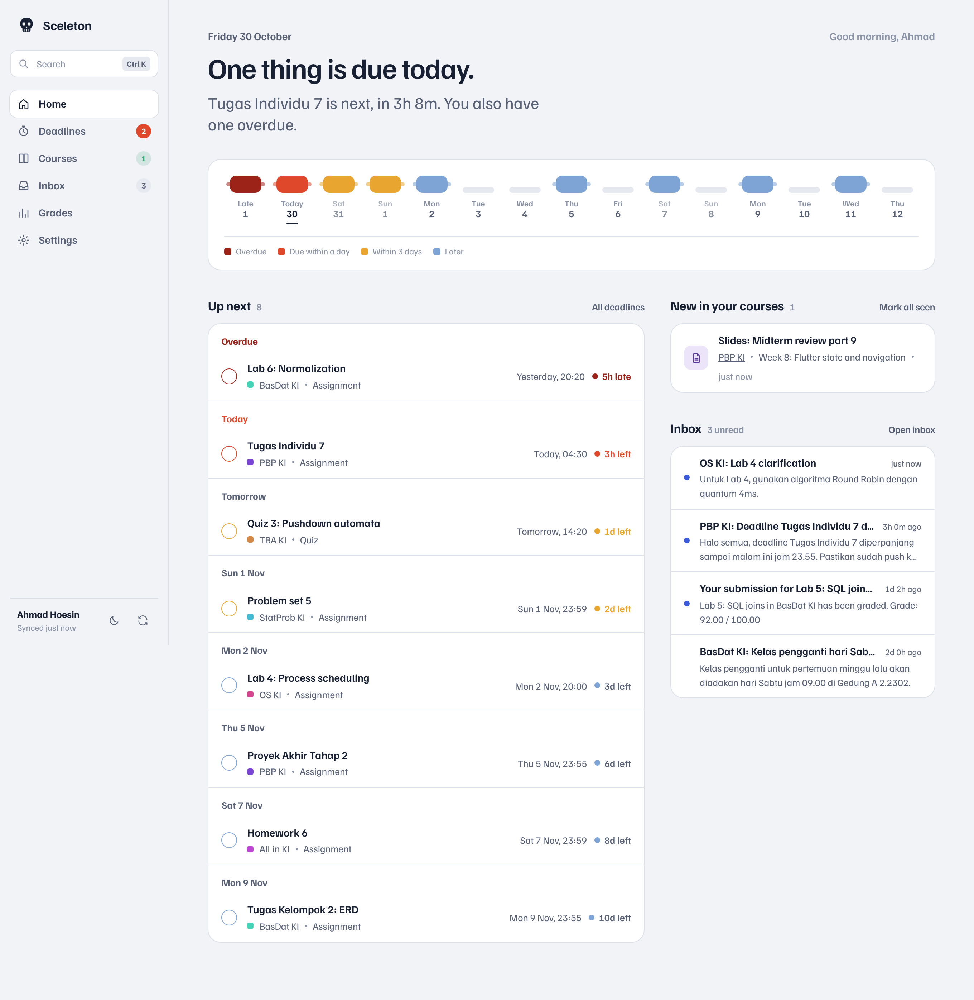
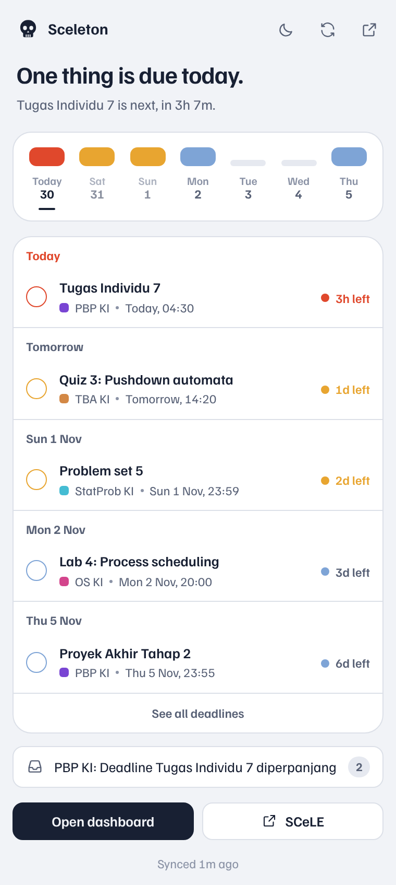
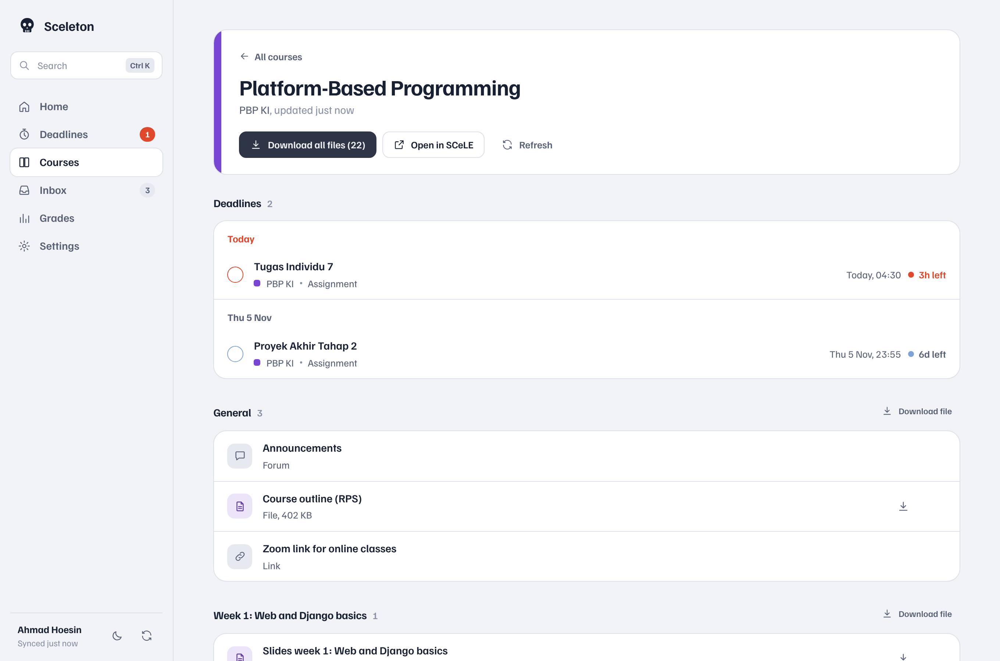
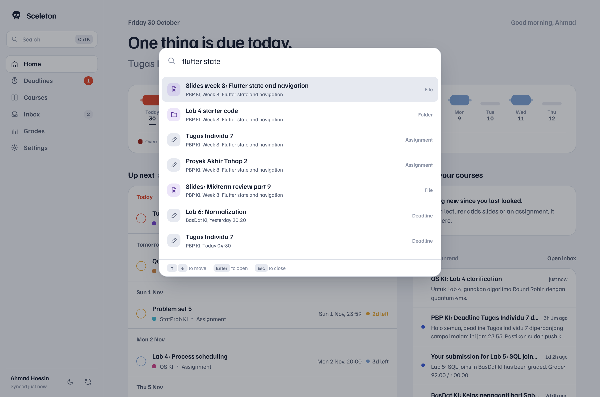
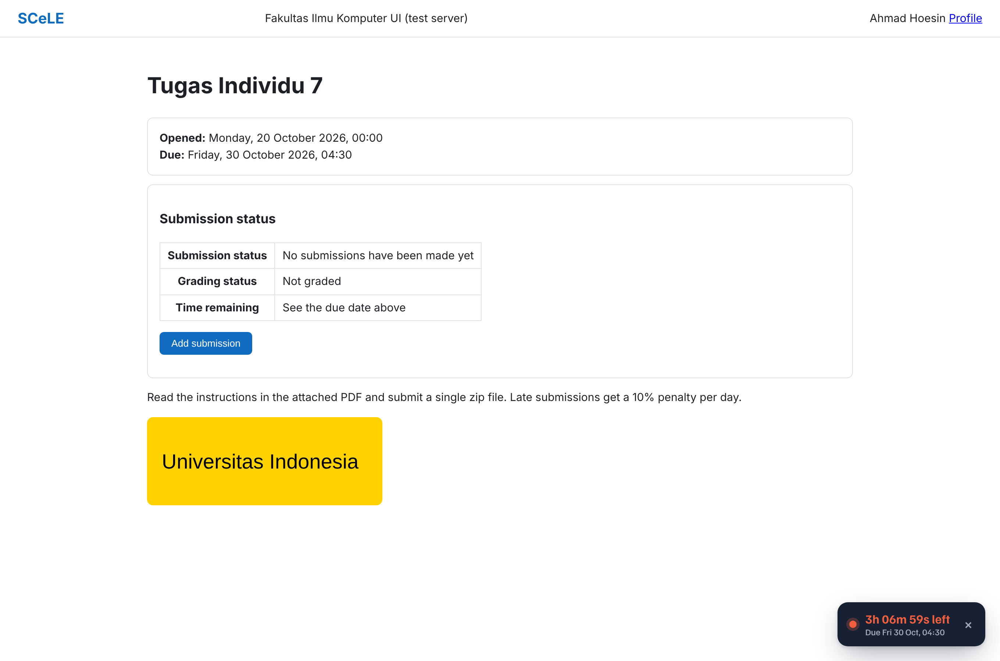
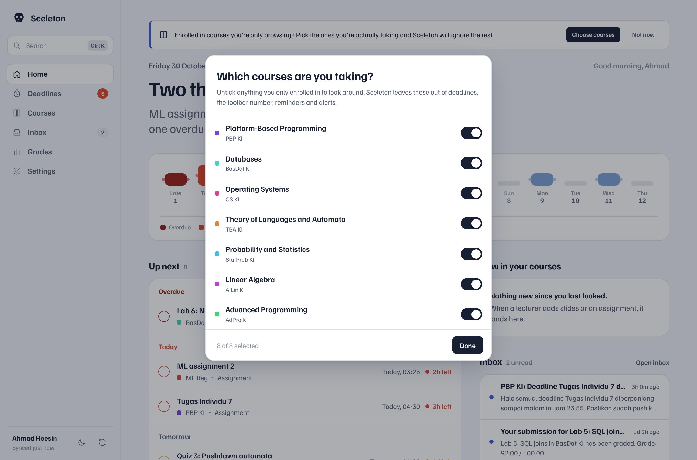
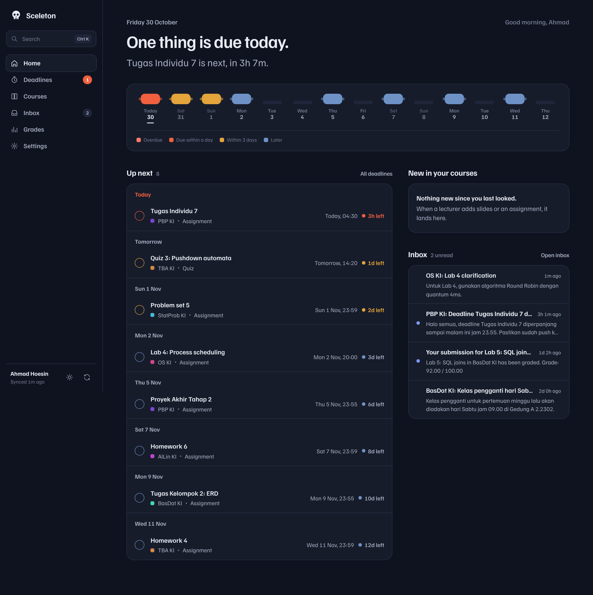

<p align="center"></p>

<h1 align="center">Sceleton</h1>

<p align="center">A browser extension that makes SCeLE (Fasilkom UI's Moodle) actually tell you what's due.<br>Works in Microsoft Edge and Google Chrome.</p>

<p align="center"></p>

## Why

SCeLE has everything you need, but you have to go looking for it. You open five course pages to find out what's due this week, you miss the announcement that moved a deadline, and you find out a lecturer uploaded new slides only when someone asks about them in the group chat.

Sceleton sits in your browser and does the looking for you.

## What it does

- **Shows what's due at a glance.** The number on the toolbar icon is how many things are due in the next 24 hours. Click it for the next few deadlines.
- **Reminds you before deadlines.** Normal desktop notifications, 1 day and 3 hours before by default. You can pick 1 week, 3 days, 1 day, 6 hours, 3 hours or 1 hour.
- **Tells you when a lecturer uploads something.** It checks your course pages every 30 minutes and notifies you when new slides, files or assignments appear.
- **Lets you pick the courses you're actually taking.** Enrolled in a course just to look at the material? Untick it, and it stops showing up in deadlines, reminders and alerts.
- **Downloads course files into tidy folders.** One click and every file goes to `Downloads/SCeLE/<course>/<week>/`. Next time it only grabs what's new.
- **Searches everything.** Press Ctrl K (or ⌘ K) to search courses, files, deadlines and announcements. It handles typos.
- **Collects announcements and grades in one place**, with an inbox for SCeLE notifications and a grades page with the full breakdown per course.
- **Adds deadlines to your calendar** as an .ics file that works with Apple Calendar, Google Calendar and Outlook.
- **Makes SCeLE itself nicer.** Optional dark mode for the SCeLE website, and a live countdown in the corner of every assignment and quiz page.

The two week strip at the top of the dashboard is the "spine": one vertebra per day, bigger and redder when more is due. It shows how your week is going at a glance.

| | |
|---|---|
|  |  |
|  |  |
|  |  |

## Install

You don't need a terminal for this.

### Microsoft Edge

1. Download `sceleton-extension.zip` from the [latest release](../../releases/latest) and unzip it.
2. Go to `edge://extensions`.
3. Turn on **Developer mode** (bottom left).
4. Click **Load unpacked** and choose the unzipped folder (the one with `manifest.json` inside).
5. Click the puzzle piece icon in the toolbar and pin Sceleton (the eye icon) so the number is always visible.
6. Log in to [SCeLE](https://scele.cs.ui.ac.id) like you normally do. Sceleton picks it up by itself.

### Google Chrome (and Brave, Arc, Opera)

Same steps, but go to `chrome://extensions` and the Developer mode switch is at the top right.

> Edge may show a warning about developer mode extensions when you start it. That's normal for extensions you load yourself. Just keep it on.

### Updating

Download the new release, replace the old folder with the new one, then press the reload button on Sceleton's card in `edge://extensions` (or `chrome://extensions`). Your settings and data stay.

## Privacy

- **Sceleton never sees your password.** It uses the SCeLE login you already have in your browser, the same way the SCeLE website does.
- **Everything stays on your computer.** Deadlines, course pages and settings are saved in your browser's extension storage. There is no server, no account and no analytics.
- **It only talks to `scele.cs.ui.ac.id`.** You can check this in `manifest.json`: that's the only site it has permission to access.
- **It only reads.** It never submits assignments, posts in forums or changes anything on SCeLE. The only thing it marks is notifications as read, when you open them in Sceleton.

## How it works

For anyone curious, or anyone who wants to help:

- SCeLE is a Moodle site. When you're logged in, every page has a `sesskey`. Sceleton reads it from your SCeLE home page and calls the same JSON API (`/lib/ajax/service.php`) that SCeLE's own pages use, with your browser's cookies. Deadlines come from the timeline, the same data as SCeLE's own "Timeline" block.
- Some Moodle sites don't allow every function through that API. For course pages and grades there is a backup plan: Sceleton reads the normal HTML page instead. The background worker can't parse HTML, so it uses a hidden [offscreen document](https://developer.chrome.com/docs/extensions/reference/api/offscreen) for that.
- A background service worker syncs every 30 minutes with `chrome.alarms`, sets one alarm per reminder, and keeps a list of what was on each course page so it can tell what's new.
- No build step and no framework. It's plain JavaScript modules, so you can read any file and change it.

```
extension/
  manifest.json      permissions and entry points
  background.js      syncing, badge, reminders, notifications, downloads
  lib/scele.js       talking to SCeLE (API calls and HTML fallbacks)
  lib/data.js        keeping the saved copy up to date, spotting new material
  lib/store.js       settings and storage helpers
  lib/views.js       pieces shared by the popup and dashboard (the spine, deadline rows)
  app/               the dashboard
  popup/             the toolbar popup
  content/           runs on SCeLE pages: login detection, dark mode, countdown
  offscreen/         hidden page that parses HTML for the background worker
dev/
  mock_scele.py      a fake SCeLE for testing without an account
  build-dev.mjs      makes a copy of the extension that points at the fake SCeLE
  e2e.mjs, test.sh   end to end tests in a real Chromium
cli/                 a small command line version, if you like terminals
```

## Development

You need Python 3 and Node 18 or newer.

```bash
# start a fake SCeLE on http://127.0.0.1:8765 (log in with any username, password "pw")
python3 dev/mock_scele.py

# build a copy of the extension that uses it, then load dev/build/extension as unpacked
node dev/build-dev.mjs
```

The fake server has a few extra endpoints for trying things out, like `POST /__dev/add-material?course=101` to pretend a lecturer uploaded new slides. Run it with `--limited` to act like a Moodle that blocks some API calls, so the HTML fallbacks get used.

To run the end to end tests (they also refresh the screenshots in `docs/screenshots`):

```bash
cd dev && npm install && bash test.sh
```

## Notes

- This is a student project. It is not made by, endorsed by or affiliated with Universitas Indonesia or Fasilkom UI.
- If SCeLE changes how its pages look, the HTML fallbacks might need updating. Issues and pull requests are welcome.

## License

[MIT](LICENSE)
